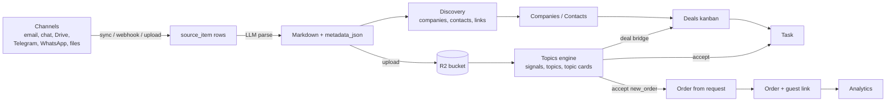

# Overview

[Back to index](./README.md)

## What the product does

salesdaily is a sales operating system for B2B companies (the first pilot tenant
is a B2B trading company). It reads the company's own communication channels,
understands them with LLMs, and keeps the CRM up to date with as little manual
typing as possible:

- It **collects** raw material from connected channels: email (Nylas or plain
  IMAP), Google Chat, Google Drive / Meet recordings, a Telegram bot, WhatsApp
  chat exports, files dropped in by hand, and saved AI-chat sessions.
- It **parses** every item with an LLM into a standard Markdown document
  (summary, content, people, companies, products, language) and stores the
  result in Cloudflare R2.
- It **discovers** companies and contacts mentioned in that material, with
  de-duplication, a blocklist and "this is us" filtering.
- It **raises signals** («карточки», cards) on the home page: short
  "analysis + recommendation" items that an operator accepts (creates a task or
  an order) or rejects.
- It **tracks deals** on a kanban sales funnel; an LLM can create deals and move
  them between stages from source material.
- It **builds orders** from a product catalog, including an LLM-assisted flow
  that turns a pasted client message into a draft order, and sends the order
  to the client through a no-login confirmation link.
- It **reports** on sales (booked orders) and answers analytics questions in
  natural language.
- An **AI chat panel** on every page searches all CRM records and the web, shows found records as a list and statistics as charts, keeps each user's chats, and passes what users tell it to the org's sources.
- It **notifies** each person in the bell («Уведомления»): task reminders,
  deal risks, topics that need attention, AI limits and process errors (owners).
- It **keeps people over time**: a contact can move to another company or work
  for two; the system proposes the change from the mail and a person decides.

The UI language is Russian. Code, database names and these docs are English.

## Who uses it

| Role | Where it comes from | What they do |
| --- | --- | --- |
| Org member | `member.role = member` | Day-to-day work: companies, contacts, deals, orders, tasks, cards, sources processing |
| Org admin | `member.role = admin` | Same as member in most modules (most modules treat all org roles equally) |
| Org owner | `member.role = owner` | Also manages members/invitations, organization profile, org sources (credentials, auto-parse), discovery blocklist, own-org identity registry, custom fields, the deal funnel; the only receiver of AI usage / billing / company profile / process notifications; reviews the golden set («Проверка эталона», also org admins) |
| Platform admin | `user.role = admin` | Everything in «Настройки» (Settings): all users and orgs, source templates, all sources, source teardown (one «Источники» tab), pipeline run + stats |
| Guest (client) | Holder of an order link token | Reviews, adjusts quantities and confirms one order at `/o/[token]`, no account |

## Main business flow (end to end)

Step by step:

1. **Connect a source.** An org owner adds a source from a template on
   «Источники» (Sources) and enters credentials (stored encrypted).
2. **Ingest.** Items arrive by remote sync (Nylas, IMAP, Google Chat, Drive),
   by webhook push (Telegram), by upload (Drop Off, WhatsApp archive), or from
   the AI chat (automatic: what users tell the chat becomes chat-note items). Each item is a `source_item` row; attachments become child rows.
3. **Process.** Each item is parsed by an LLM (via the Vercel AI Gateway; the
   model per kind of content is chosen by the admin, default Gemini 2.5 Flash)
   into Markdown, then uploaded to object storage (Cloudflare R2). The daily cron runs
   sync → parse → upload automatically for sources with auto-parse on; the
   Sources page offers the same actions by hand («Обработать», Process).
4. **Discover.** On «Компании» (Companies) the operator runs discovery
   («Найти в источниках», Find in sources). It proposes new companies, contacts
   and contact-to-company links; the operator reviews and applies.
5. **Signals.** The topics engine turns parsed items into topics and topic cards.
   On «Домашняя» (Home) the operator sees them (topics mode `on`; in `off` /
   `shadow` only the read-only history of old cards). Accepting a card creates a
   task (or, for a `new_order` card, an order draft); rejecting needs a reason.
6. **Deals.** On «Сделки» (Deals) deals move across the funnel by drag, by the
   the topics deal bridge (deal proposals and stage confirmations, see
   [modules.md](./modules.md#deals)).
7. **Orders.** On «Заказы» (Orders, route `/products`) the rep builds an order
   from the catalog, sends a confirmation link to the client, then finalizes it.
8. **Tasks and analytics.** «Задачи» (Tasks) holds the follow-up work;
   «Аналитика» (Analytics) reports on booked orders.

## Modules (one line each)

| Module | Purpose | Main page |
| --- | --- | --- |
| Sources & parsing | Connect channels, ingest items, LLM-parse to Markdown, store in R2 | `/sources` «Источники» |
| Discovery | Find companies, contacts, links in parsed items; blocklist; own-org identity | `/clients` (dialog) |
| Cards | Topic cards from the topics engine; read-only history of old Custom-rule cards | `/dashboard` «Домашняя» |
| Companies & contacts | Company and person records, web lookup and batch web enrichment, custom fields, company profile, contact ↔ company links over time (current / former, two companies, «Контакт сменил компанию?», merge) | `/clients` «Компании», `/contacts` «Контакты» |
| Documents | Files of companies, contacts, deals, tasks, orders: originals stored, linked automatically and by hand | «Документы» tab in each drawer |
| Deals | Kanban sales funnel, deal journal, deal bridge from topics | `/deals` «Сделки» |
| Products / catalog | Read-only product catalog with hybrid search and price-list export | `/products` tab «Каталог товаров» |
| Orders | Order builder, per-client discount, guest confirmation link, order from request | `/products` tab «Заказы» |
| Tasks | Task list/cards, timeline, links to clients, contacts, deals | `/tasks` «Задачи» |
| Analytics | Sales reporting over booked orders + an analytics AI assistant | `/analytics` «Аналитика» |
| Global search | Cross-entity search box in every page header | header |
| AI chat panel | Chat over CRM data and the web, on every page | header button |
| Notifications | Bell in the header: stored notifications per user, categories, important / info, hourly checks (tasks, AI limits, profile, sources) | header |
| Admin tools | Users, orgs, templates, sources, source teardown; AI models registry, model per AI process + model rules, AI usage statistics + markup + daily AI budget; topics engine operations «Темы» (modes, runs, CRM checks, delivery), the signals registry «Сигналы», and «Тесты и отладка» (signal review, topic debug, golden set, eval) | `/settings` «Настройки» |
| Profile & organization | User profile, org profile, members, invitations, AI usage with markup (owners), notification settings, «Проверка эталона» (golden-set review, owners / admins) | `/profile`, `/account` |

## Navigation (sidebar)

Top block: «Домашняя» (Home, `/dashboard`), «Компании» (Companies, `/clients`),
«Контакты» (Contacts, `/contacts`), «Сделки» (Deals, `/deals`), «Заказы»
(Orders, `/products`), «Задачи» (Tasks, `/tasks`), «Аналитика» (Analytics,
`/analytics`).

Bottom block: user profile (`/profile`), organization (`/account`),
«Источники» (Sources, `/sources`), «Настройки»
(Settings, `/settings`, platform admins only), «Выйти» (Sign out).

The sidebar remembers open / closed (cookie), and every page reopens on the
tab / view the user had open last (per browser; a `?tab=` link wins).

Routes that exist but are not in the sidebar: `/clients/[id]` (company page,
reached from global search), `/cards/[id]` (card detail, reached from global
search), `/cards` and `/docs` (empty placeholder pages), `/review` (redirects to `/account?tab=review`).

## Glossary

| Term | Russian UI name | Meaning |
| --- | --- | --- |
| Organization / org | «Организация» | The tenant. All business data is scoped to one org. |
| Active organization | — | The org stored on the user's session; every query filters by it. |
| Source | «Источник» | One configured channel of one org (a `source` row), e.g. "Emails" (Nylas). |
| Source template | «Шаблон» | Platform-wide catalogue entry from which org sources are created. |
| Provider | — | Technical kind of source: `nylas`, `imap`, `gchat`, `gdrive`, `dropoff`, `whatsapp`, `aichat`, `telegram`. |
| Source item | «Материалы источников» (Source materials) | One ingested unit (email, chat message, file, attachment) — a `source_item` row. |
| Parsing / processing | «Разбор» (Parse), «Загрузка» (Upload), «Обработать» (Process) | LLM conversion of an item to Markdown, then upload of that Markdown to R2. |
| Auto-parse flag | «Авторазбор» (Auto parse) | `source.automated_parsing_is_allowed`; when off, the daily pipeline skips the source. |
| Own-org attribution | — | Parse-time verdict whether the org itself authored an item (`own_org` / `external` / `unknown`). |
| Discovery | «Найти в источниках» (Find in sources) | Read-only scan of parsed items that proposes companies, contacts and links. |
| Blocklist | «Список блокировки» | Org dictionary of companies/people/domains/emails that discovery must ignore. |
| Own-org identity | «Своя организация» | Extra names, websites and addresses that mean "this is us, not a client". |
| Company / client | «Компания» | A `client` row. The UI says "company"; the code says "client". |
| Contact | «Контакт» | A person with current and former companies («Компании»: one primary = `contact.client_id`, others e.g. «Консультант»), and extra addresses («Адреса»: old / second email, phone, Telegram). |
| Contact change proposal | «Контакт сменил компанию?» | A proposal from the sources (farewell, new address, same name at another client, two companies in 60 days) that a person decides: «Перешёл», «Работает с обеими», «Это другой человек», «Не сейчас». |
| Notification | «Уведомление» | A stored message for one person in the bell: category, «Важное» / «Информация», read / hidden, «уже не актуально» when the condition is gone. |
| Rule | «Правило» | A stored LLM prompt (`rule` table). No UI edits it any more; old cards still reference it. |
| Card | «Карточка» | One LLM-made signal: priority, category, analysis, recommendation. |
| Deal | «Сделка» | A sales opportunity for one company, placed on a funnel stage. |
| Funnel stage | «Этап» | A deal stage with a closure probability; system stages or org-customised ones. |
| Pre-pipeline stage | «Контакт до запроса», «до воронки» | Optional stage 0 in front of the funnel (contact without a concrete request). |
| Deal activity | «Хронология», «Лента решений» (Decision feed) | Append-only journal of deal creation and stage moves. |
| Agent move | «перевёл агент» | A stage move made by the system, not a user. |
| Product / catalog | «Каталог товаров» | The org's product list (read-only in the app). |
| Order | «Заказ» | A client order: draft → awaiting client → confirmed → finalized / cancelled. |
| Guest order link | link at `/o/<token>` | Capability link: whoever holds the token can review and confirm one order. |
| Order from request | «Новый заказ» with pasted text | LLM split of a free-text client message into items, then a guided wizard. |
| Booked order | — | Order with status `confirmed` or `finalized`; the only orders counted as revenue. |
| Teardown | «Сброс источника» (Source reset) | Admin hard delete of selected threads of a source and what they produced. |
| Pipeline run | «Статистика обработки» (Processing statistics tab on Sources, admins) | One execution of the daily sync → parse → upload job. |
